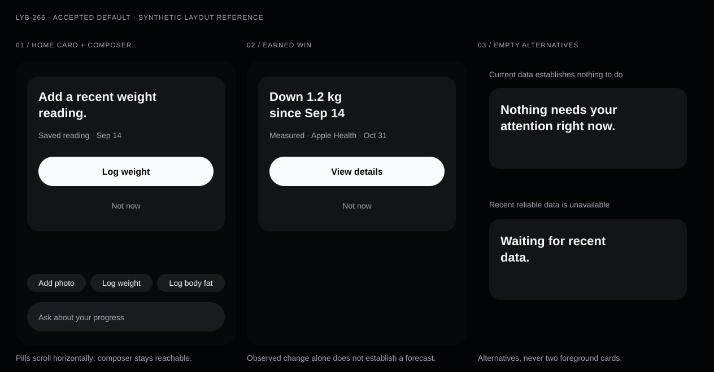

# Home single-focus presentation (LYB-266)

Recorded October 31, 2026. Parent: LYB-173. **Accepted default** under the
issue's “ships if unanswered” instruction; no separate human visual review is
claimed. This resolves the presentation question and creates the three UI
implementation slices below. It does not implement the native UI.

The [decision record](home-single-focus-presentation.json)
owns the copy and presentation contract. It extends the accepted
[LYB-302 wording](home-coaching-card-wording.json)
and follows [LYB-305 win eligibility](earned-win-eligibility.json).
The [brand ethos](../../../docs/product/brand-ethos.md),
[evidence standard](../../../docs/product/evidence-and-recommendation-standard.md) and
[current product direction](../../../docs/product-development-roadmap.md#october-16-supersession-current-product-behavior)
govern all three slices.

## Visual decision

This is a static layout reference with synthetic data, not a native screenshot,
snapshot baseline or evidence of a customer outcome. The action, win and calm
panels are mutually exclusive alternatives in the same foreground slot.

- **Home card:** one full-width, leading-aligned neutral card. One concise
  sentence leads; source, observation date and confidence sit quietly below it.
  An actionable card has one full-width primary capsule and a quiet “Not now”
  text button. Passive calm states need neither. Details stay reachable through
  existing destinations. “Not now” never accepts a plan or clears safety state.
- **Pills:** one horizontally scrolling row immediately above the existing
  composer. Compact neutral capsules use action labels, without counts or
  urgency. Preserve `QuickPillRanker` order. The composer remains reachable
  when “Ask a question” has scrolled out of view.
- **Win and empty states:** use the same card treatment. Wins report a supported
  number and date, or a verified first milestone and date. No confetti, trophies,
  forced overlay, celebration haptics, sound or animated counters. Known quiet
  and unknown data are visibly different states.

Use the existing native Jovie primitives and semantic tokens in
[Theme.swift](../../../apps/ios/LogYourBody/DesignSystem/Theme.swift) and
[HomeV2Tokens.swift](../../../apps/ios/LogYourBody/Views/HomeV2/HomeV2Tokens.swift):
`HomeV2Palette.canvas/card/ink/secondary/ctaFill/ctaInk`,
`JovieTokens.screenInset` (20pt), `cardRadius` (20pt), `tightGap` (8pt),
`itemGap` (12pt) and `sectionGap` (28pt). Card padding uses `screenInset`.
The primary capsule uses `controlHeight` (52pt); compact capsules use the
locked native `actionControlHeight` (32pt visible) inside at least
`minimumHitTarget` (44pt). Preserve native geometry rather than web density.
Use SF system text with semantic Dynamic Type scaling, a semibold leading
sentence, regular secondary proof, and medium capsule labels. No new token
family, decorative gradient or color-based judgment of weight direction.

All heights grow for large text. Wrap sentences and labels without truncating
facts or shrinking text to fit. Maintain AA contrast, native Button semantics,
logical VoiceOver order and nonoverlapping 44pt targets, including “Not now.”
Use only existing functional transition tokens; Reduce Motion removes movement.

## Copy decision

Keep the six LYB-302 sentences verbatim under their existing conditions. Their
actions are fixed in the record: “View progress,” “Add photo,” “View workout”
and “View plan.” A successful Apple Health import remains a quiet receipt;
its arrival alone does not earn a celebration or a foreground task.

| Additional card state           | Sentence                                | Primary action |
| ------------------------------- | --------------------------------------- | -------------- |
| Valuable missing/stale weight   | Add a recent weight reading.            | Log weight     |
| Valuable missing/stale body fat | Add a recent body fat reading.          | Log body fat   |
| Stored engine plan revision     | Your plan has an update.                | Review plan    |
| No reliable recent data         | Waiting for recent data.                | None           |
| Verified calm                   | Nothing needs your attention right now. | None           |
| Eligible earned win             | Verified fact using the templates below | View details   |

Use only selector-admitted asks. A safety-related plan update retains its
engine-owned explanation and restrictions; generic copy must not hide them.
Reuse existing recovery copy/actions for loading, offline and error states.
Never show the verified-calm sentence solely because selection has no candidate.

| Ranker value | Capsule label  |
| ------------ | -------------- |
| `addPhoto`   | Add photo      |
| `weight`     | Log weight     |
| `bodyFat`    | Log body fat   |
| `plainInput` | Ask a question |

Keep the existing composer placeholder: “Ask about your progress.” Capsule
activation opens the existing flow; plain input focuses the composer and sends
nothing. Accessibility names match these labels; decorative icons stay hidden.

Win examples below are synthetic, conditional examples, never universal claims:

| Eligible event              | Example                                      | Required support                                                     |
| --------------------------- | -------------------------------------------- | -------------------------------------------------------------------- |
| Goal-relative weight change | Down 1.2 kg since Sep 14                     | Reliable stored change toward an explicit safe user-selected goal    |
| Same change with a forecast | Down 1.2 kg since Sep 14, on track for Dec 1 | Separate current forecast supporting the user's selected target/date |
| First meaningful milestone  | First progress photo saved on Oct 31.        | Complete history verifies first-ever status and goal relevance       |
| Measured time saved         | Logging took 6 minutes less than on Oct 24.  | Comparable measured durations for the same task                      |

“Up” is equally valid when it describes progress toward the user's goal. For
body fat use percentage points; for FFMI name the metric in the unit label.
Format units, numbers and dates for the user's locale, adding years when the
comparison would otherwise be ambiguous. Qualify estimated/interpolated values
and show actual source, period and confidence without inventing a score.
Do not equate weight loss, a shorter workout or a saved import with benefit.

`EarnedWinDetector` supplies no deadline forecast. Omit the entire “on track
for …” clause when one is unavailable; a favorable change cannot establish it.
Render the supported fact without that clause. Suppress an unsupported win and
use the appropriate known-quiet or unknown state. Preserve deduplication and
acknowledgement ownership in the detector/integration slice.

## UI implementation slices

These are three created repository-local work specifications, ready for the
existing iOS delivery lane. The keys below are local identifiers, not Linear
issue IDs. Each is one reviewable UI PR; shared rollout uses
`ios_home_single_focus_v1`, default off through the existing platform port.
This record neither creates nor enables a live gate. Reuse the active Home and
composer path; the historical photo-first target does not authorize a second
Home implementation. Do not change selector, ranker, detector or training rules.

### Slice: Home card

Key: `home_card`. Dependencies: `HomeFocusSelector`, LYB-302.

Integrate the selected presentation into the existing Home slot using the
shared native card/button primitives. Consume prepared display values, keep
collection processing and I/O off the main actor, and route its one action to
the existing flow. Defer optional cards through the existing policy. Preserve
safety restrictions and the gate-off Home. Do not implement a new selector.

Acceptance: exactly one foreground card and at most one primary button;
source/date/confidence readable; “Not now” defers without accepting/completing
anything; loading disables repeated activation without shifting layout;
long copy and accessibility text fit. Capture actionable, long-copy,
loading/disabled and gate-off snapshots with deterministic synthetic fixtures.
Assert action routing, accessible names and dismissal behavior separately.

### Slice: Composer pills

Key: `composer_pills`. Dependency: `QuickPillRanker`.

Wire ranker output to the existing composer as one horizontal capsule row.
Reuse existing logging/photo routes and focus the existing text field for
plain input. Preserve the returned order and omitted fresh-weight action;
do not add prompts or change freshness/value rules.

Acceptance: exact labels above, one row with horizontal overflow, keyboard-safe
placement, independent 44pt targets and a reachable composer at all text sizes.
Capture all-missing, all-fresh, overflow, keyboard-visible and gate-off
snapshots. Assert order and routing, plain-input focus without a sent message,
and VoiceOver access when the plain-input capsule is offscreen.

### Slice: Win and empty

Key: `win_and_empty`. Dependencies: `EarnedWinDetector`, `home_card`, LYB-305.

Render already eligible wins and distinct known-quiet/unknown states in the
same foreground slot. Use the approved templates, real source dates and
supported precision; the “View details” action opens existing evidence detail.
Keep forecasting, eligibility and acknowledgement policies with their owners.

Acceptance: no fabricated impact, unsupported forecast or repeated celebration;
no win inferred from a fresh import alone; no calm state covering an unresolved
error. Capture gain with/without forecast, first-ever, measured time-saved,
verified-quiet, unknown and gate-off snapshots. Test missing/stale evidence,
estimates, unit/locale/year boundaries, unsafe/absent goals, repeated wins and
unsupported forecasts against producer contracts; do not create eligibility
rules in the view.

For every slice, use the real native runner and retain exact-commit snapshots
at a compact iPhone width and the existing iPhone test destination, default and
accessibility Dynamic Type, and Reduce Motion. Compare fixtures deterministically
and verify contrast/VoiceOver alongside images. Snapshot cases are specified
here; none have been executed or approved as native baselines by this decision.
Real-device TestFlight evidence remains with LYB-173.
